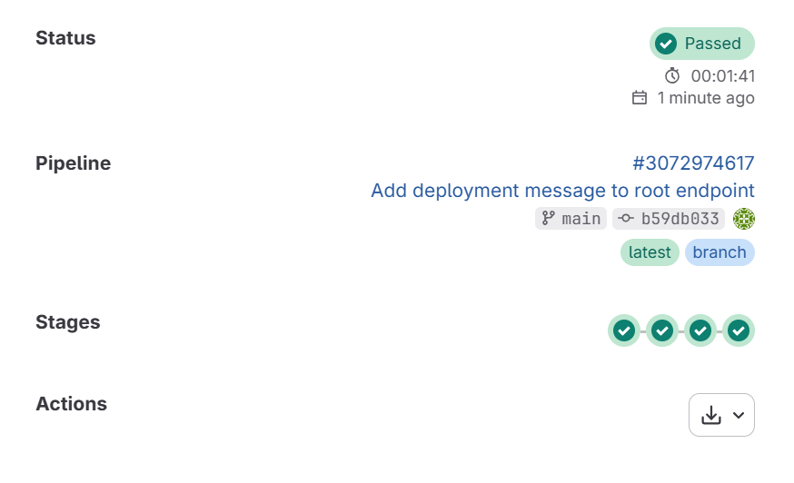
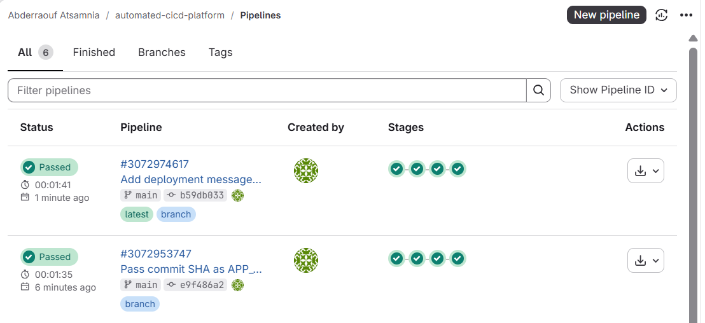
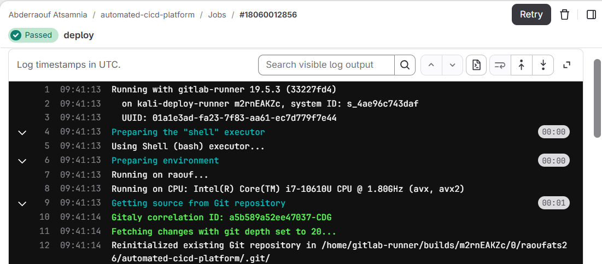
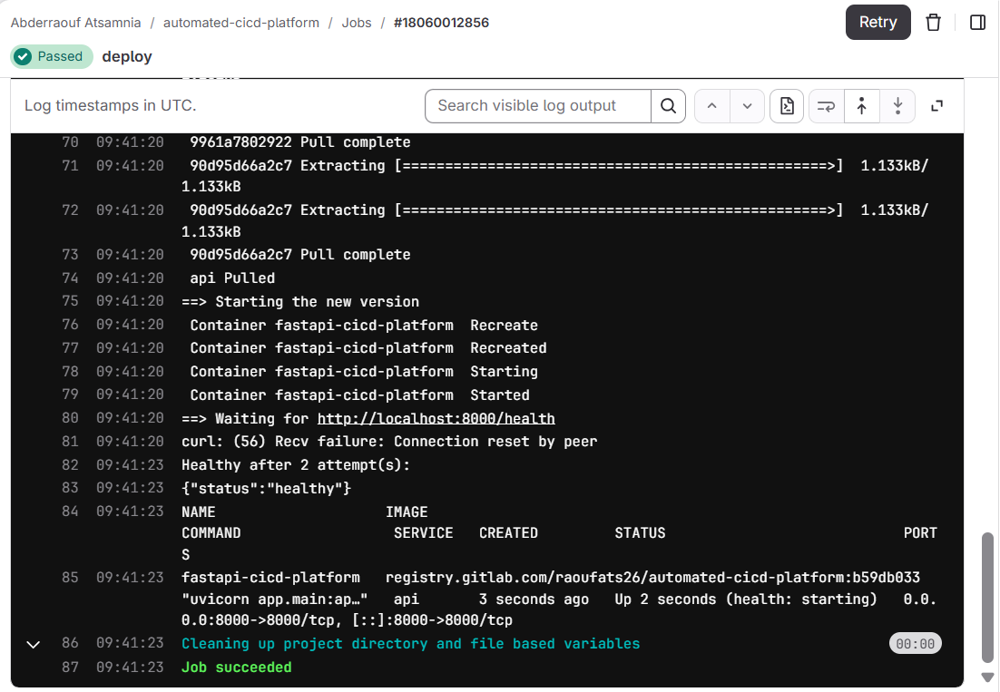
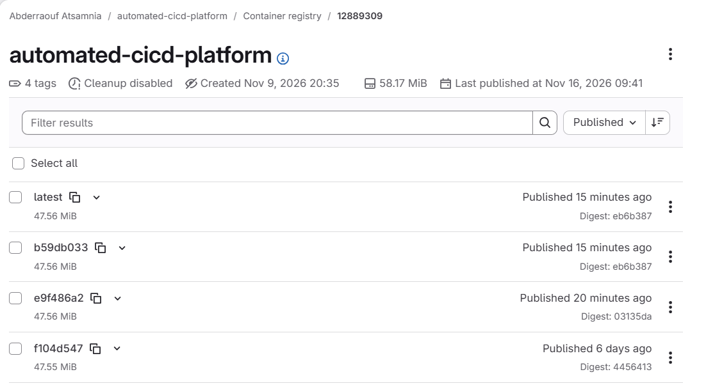
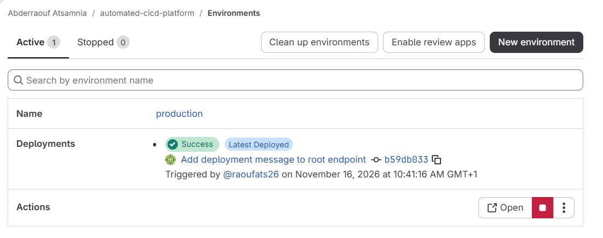
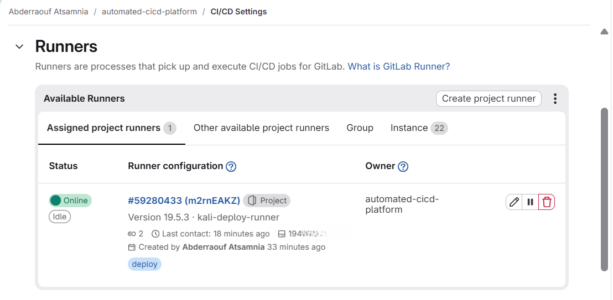
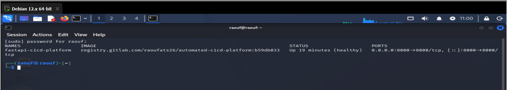
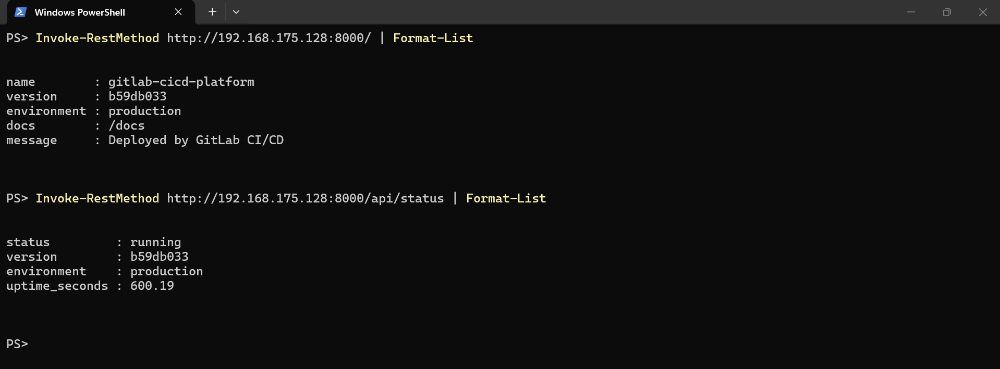
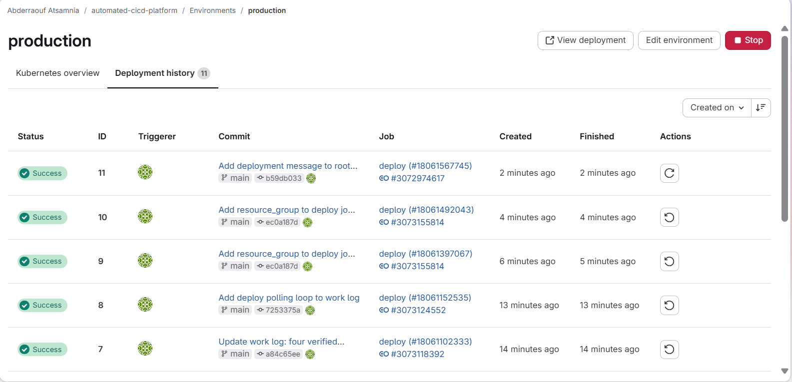

# GitLab CI/CD Platform

A small FastAPI application that will be tested, built, published and deployed
automatically by a GitLab CI/CD pipeline onto a Linux server running Docker Compose.

> **Status:** Phase 1 — application foundation (no Docker or CI yet).

## Target architecture

```
Developer -> GitLab Repository -> GitLab CI/CD -> GitLab Runner
   Pipeline: validate -> test -> build -> publish -> deploy -> verify
```

## API endpoints

| Method | Path              | Description                        |
|--------|-------------------|------------------------------------|
| GET    | `/`               | Application information            |
| GET    | `/health`         | Health check                       |
| GET    | `/api/status`     | Application status and uptime      |
| GET    | `/api/users`      | List example users                 |
| GET    | `/api/users/{id}` | One user (404 if it does not exist)|

Interactive documentation is generated automatically at `/docs`.

## Project structure

```
app/            Application code (FastAPI)
tests/          Automated tests (Pytest)
requirements.txt  Python dependencies
```

## Run locally (Windows / PowerShell)

```powershell
py -m venv .venv
.\.venv\Scripts\Activate.ps1
pip install -r requirements.txt

# Run the tests
pytest -v

# Start the API at http://127.0.0.1:8000
uvicorn app.main:app --reload
```

## Configuration

| Variable      | Default       | Purpose                   |
|---------------|---------------|---------------------------|
| `APP_ENV`     | `development` | Environment name          |
| `APP_VERSION` | `1.0.0`       | Version shown by the API  |

## Results / Evidence

Screenshots from a real run: pipeline `#3072974617`, commit `b59db033`, deployed to a Kali Linux VM.

**1. Green pipeline.** All four stages (validate, test, build, deploy) pass on `main`.


**2. Pipelines list.** Each push to `main` triggers a full automated run.


**3a. Deploy job runner.** The deploy job runs on the self-managed `kali-deploy-runner` with the shell executor.


**3b. Health check.** The first health check fails during container startup; the retry loop succeeds on attempt 2.


**4. Container Registry.** `latest` and `b59db033` share the same digest; deploys always use the commit tag; older tags enable rollback.


**5. Environment.** GitLab tracks what is deployed to production, by whom and when.


**6. Runner online.** The project runner tagged `deploy` is online and idle.


**7. Server container.** The image is pulled from the registry, never built on the server.


**8. Version live.** `/api/status` from Windows shows the deployed commit SHA.


**9. Rollback.** Production went back from `ec0a187d` to `b59db033` using the existing registry image, with no rebuild (deployment ID 11, re-run from the old pipeline #3072974617).


## Roadmap

1. Application foundation: done
2. Local Docker environment: done
3. Git and GitLab: done
4. GitLab CI/CD and Runner: done
5. Container registry: done, verified (tag `f104d547` still in the registry 6 days after it was pushed)
6. Linux deployment: done, verified by automated deploys `e9f486a2` and `b59db033`
7. Reliability & security: **in progress**. Verified: runner token rotation, `resource_group: production` (deploy `ec0a187d`), rollback via GitLab Environments (production `ec0a187d` to `b59db033`, no rebuild). Remaining: docs-only rules, Trivy image scanning, registry cleanup policy, security decisions & limitations
8. Monitoring (optional)
9. Portfolio & documentation
